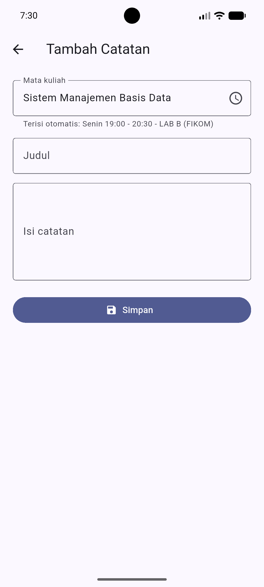
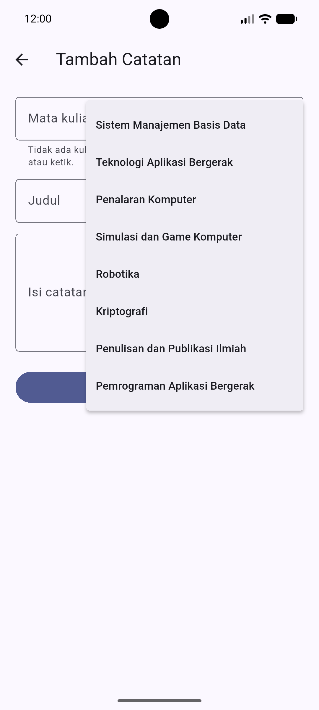
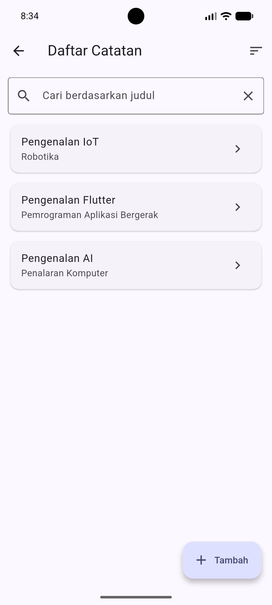
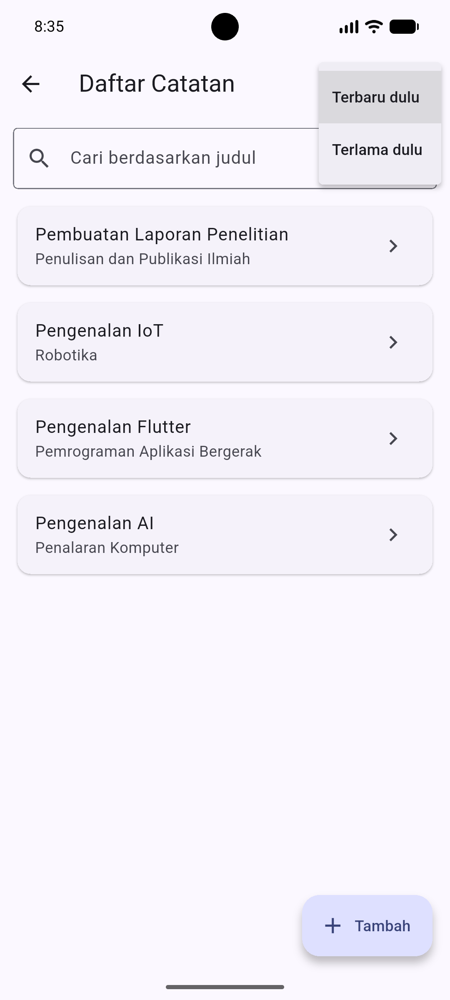
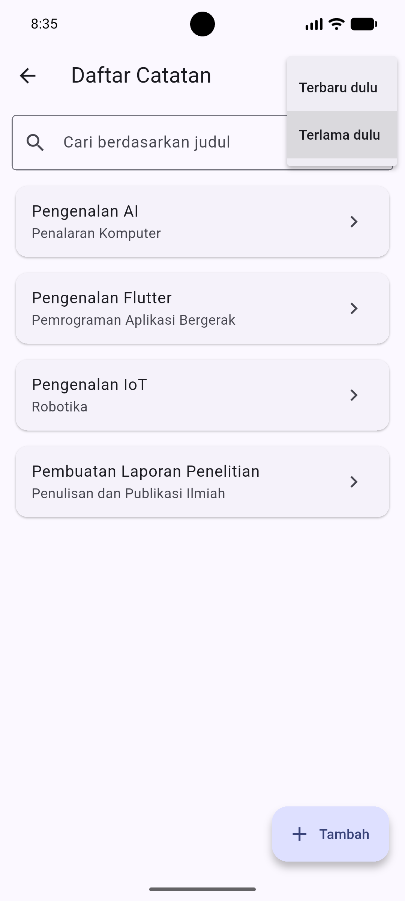
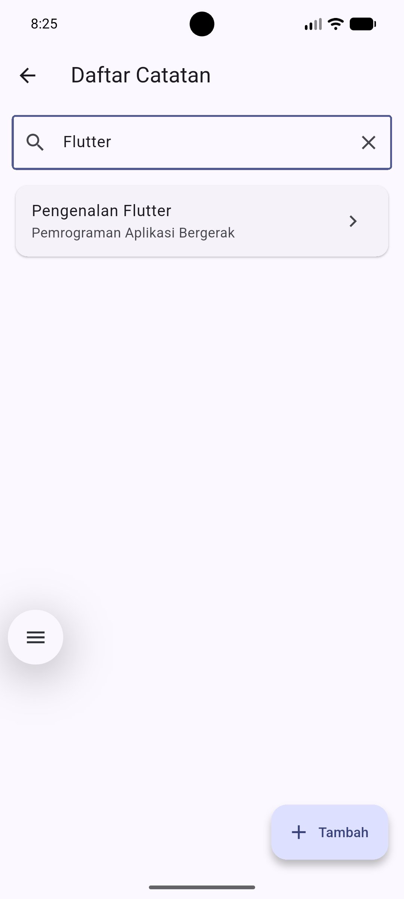
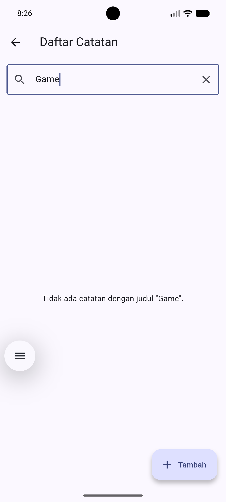

# StudyLog — Aplikasi Catatan Perkuliahan

Aplikasi Android berbasis Flutter untuk mencatat materi kuliah secara offline
(data tersimpan di SQLite lokal). Mata kuliah
**Pemrograman Aplikasi Bergerak** — Universitas Mulia Balikpapan, Kelas **IFB5J**.

## Anggota Kelompok

| Nama | NIM | Kontribusi utama |
| --- | --- | --- |
| Rizky Ilham Febrianto | 2211002 | Setup proyek, M1 (form interaktif), M3 (SQLite & CRUD), fitur isi otomatis mata kuliah |
| Ahmad Bagus Rudyanto | 2411004 | M2 (navigasi & Provider), fitur cari catatan |
| Rahma Aulia Sarita Zul Putri | 2411013 | Fitur urutkan catatan, README |

## Fitur

- Tambah, lihat, ubah, dan hapus catatan (CRUD) dengan penyimpanan SQLite.
- Validasi form dan dialog konfirmasi hapus.
- **Mata kuliah terisi otomatis** berdasarkan hari dan jam perkuliahan yang sedang aktif. Di luar jam kuliah, mata kuliah dapat dipilih dari daftar.
- **Cari catatan** berdasarkan judul.
- **Urutkan catatan** (terbaru / terlama).

## Tangkapan Layar

### Mata kuliah terisi otomatis

Saat ada perkuliahan yang berlangsung, kolom **Mata kuliah** terisi dan terkunci sesuai jadwal
(lengkap dengan hari, jam, dan ruang). Di luar jam kuliah, kolom dapat diketik atau dipilih dari daftar.

| Saat jam kuliah (terisi otomatis) | Di luar jam kuliah (pilih manual) |
| --- | --- |
|  |  |

### Urutkan catatan

Ikon urutkan di AppBar halaman Daftar Catatan menampilkan pilihan **Terbaru dulu** dan **Terlama dulu**.

| Menu urutkan | Terbaru dulu | Terlama dulu |
| --- | --- | --- |
|  |  |  |

### Pencarian berdasarkan judul

Kolom **Cari berdasarkan judul** menyaring daftar sesuai kata yang diketik. Jika tidak ada yang cocok,
muncul pesan bahwa catatan tidak ditemukan.

| Hasil pencarian | Judul tidak ditemukan |
| --- | --- |
|  |  |

## Cara Menjalankan

1. Pasang Flutter SDK, Android Studio (Android SDK), dan Git. Cek dengan `flutter doctor`.
2. Clone repository lalu masuk ke foldernya:
   ```
   git clone <URL-REPOSITORY>
   cd studylog_flutter
   ```
3. Ambil dependensi dan jalankan di **emulator/HP Android** (bukan Chrome):
   ```
   flutter pub get
   flutter run
   ```
4. Jalankan analisis dan pengujian:
   ```
   flutter analyze
   flutter test
   ```

## Struktur Kode

```
lib/
  main.dart
  models/catatan.dart
  data/database_helper.dart
  data/catatan_repository.dart
  data/jadwal_kuliah.dart
  viewmodels/catatan_view_model.dart
  screens/ (beranda, daftar, detail, form)
test/
  catatan_model_test.dart
  jadwal_kuliah_test.dart
docs/screenshots/   (tangkapan layar untuk README)
```

Alur: UI → ViewModel (ChangeNotifier/Provider) → Repository → DatabaseHelper (sqflite) → SQLite.

## Riwayat Pengerjaan

Seluruh pengerjaan dilakukan pada satu laptop. Setiap commit mencantumkan nama
pengerjanya pada author dan pesan commit (lihat `git log`).
